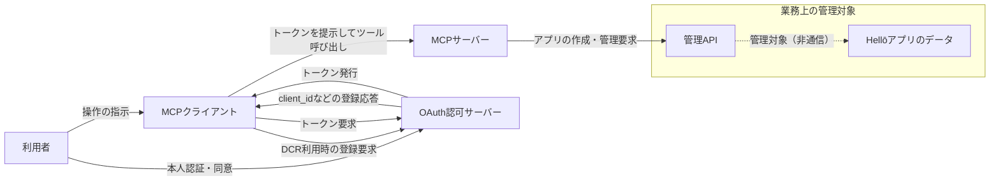
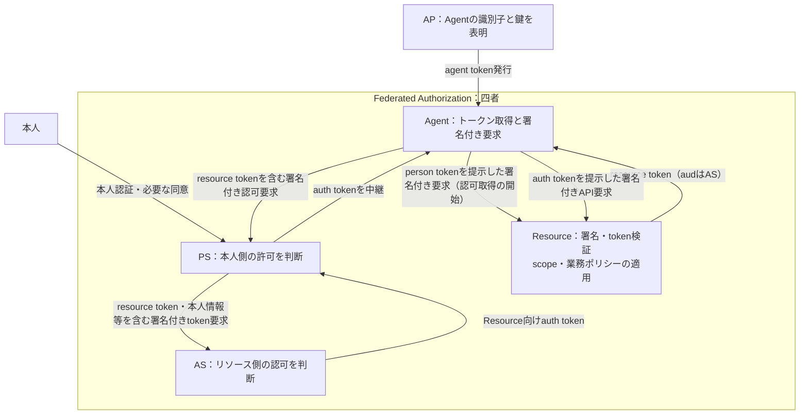
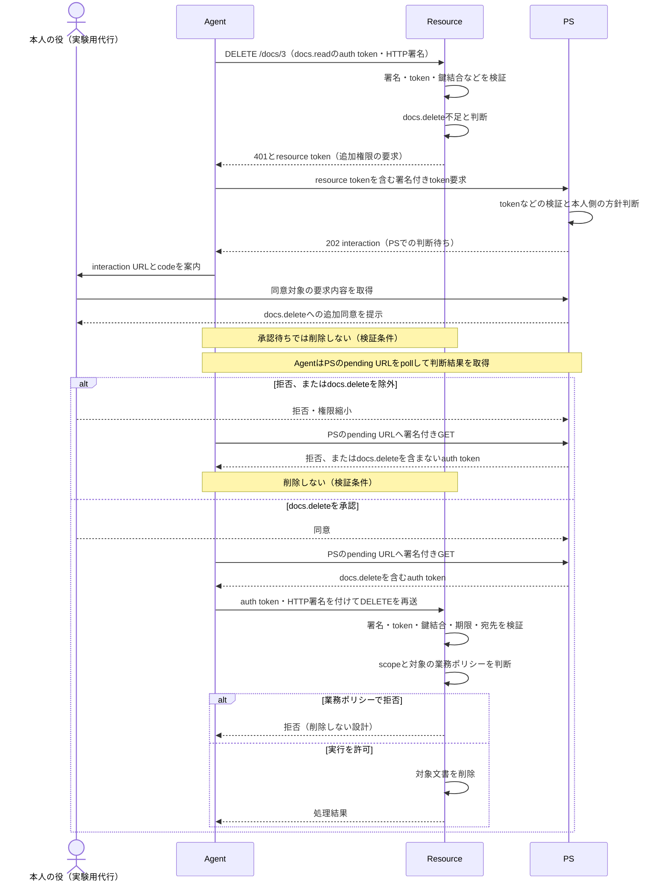

# AAuthは何を再設計するのか――AIエージェントの認可における課題と設計

> 全文初稿です。調査基準日は2026年10月9日です。2026年10月10日の執筆時に主要な一次資料を部分照合しました。仕様の説明と再現実験の対象は `draft-hardt-oauth-aauth-protocol-11` に固定します。実験結果は未実測で、記事の正式公開に向けた確認・推敲を残しています。

AIエージェントにAPI（Application Programming Interface）の利用を任せると、本人が画面で操作していたときには目立たなかった判断が表面化します。アプリを登録する権限は与えてよいとして、削除まで任せるのでしょうか。追加の許可が必要になったとき、誰に確認するのでしょうか。確認を待つ間、実行を止めるのはどのサーバーでしょうか。トークンを持つことと、その操作を実行してよいことを分けて考える必要があります。

AAuthは、こうした認可をエージェント向けに再設計する提案です。エージェントの識別、本人を代表する判断、リソース側のアクセス判断を分担し、鍵に結び付いたトークンと署名付きHTTP（Hypertext Transfer Protocol）要求で連携します。ただし、追加同意や鍵への結び付けはOAuthの拡張でも扱えます。AAuthを評価するには、機能の有無だけでなく、誰が何を判断する構成を採るのかを見る必要があります。[AAuth protocol-11](https://datatracker.ietf.org/doc/html/draft-hardt-oauth-aauth-protocol-11)

以下では、HellōのMCPサーバー開発から、OAuth拡張、MCPでの提案、AAuthの役割分担をたどります。対象はDick Hardtによる個人提出のInternet-Draftで、RFC（Request for Comments）になった標準として扱いません。後続版や editor's copy の内容も、この版の説明や実験へ取り込みません。

## 1. MCPサーバー開発で表面化した認可課題

### Hellō管理APIへの接続

2025年8月4日の記事で、HardtはHellōのアプリを作成・管理するMCPサーバーの実装を紹介しました。MCPはModel Context Protocolの略で、ここではVS Code、Cursor、Claudeなどのクライアントから、既存の管理APIをツールとして呼び出すために使われています。MCPプロトコルそのものを開発した体験とは区別して読みます。[Hardt「Say Hellō to AI」](https://blog.hello.coop/posts/say-hello-to-ai)

この事例には二種類の「登録」が登場します。一つは、利用者が管理対象のHellōアプリを作る登録です。もう一つは、APIを呼び出す側をOAuthクライアントとして登録する処理です。後者のDCR（Dynamic Client Registration、動的クライアント登録）は、クライアントのメタデータを認可サーバーへ伝え、`client_id`などを取得します。業務上のアプリを作る操作と、認可フローへ参加するクライアントの登録を混同すると、どのレコードが増え、誰が管理するのかを説明できなくなります。[DCR / RFC 7591](https://www.rfc-editor.org/rfc/rfc7591)

Hellōの管理APIを本人の権限で使う流れでは、クライアント登録の後に本人のログインと同意があり、トークンを取得してAPIを呼び出します。`client_id`はクライアントを識別する値で、本人のIDや削除の許可ではありません。登録だけで、クライアントへの信頼や個々の操作の許可が成立するわけではありません。

次の図は、登場主体と主な通信を区別するための概念図です。Hardtの実装の通信記録ではありません。OAuthクライアントの登録と、管理APIによるHellōアプリの登録は別の処理です。矢印はラベルに示した通信またはAPI内部の操作対象との関係を表します。

DCRの応答は呼び出し側の識別情報です。管理対象のアプリを作る要求は、MCPサーバーから管理APIへ送られます。この図では、トークンの形式や管理APIへの資格情報の渡し方を規定していません。

### クライアント登録の運用

Hardtは、利用者が開発環境を切り替えるたびに登録が増え、使われなくなった登録のライフサイクルを管理する負担を懸念しました。記事で述べた対応は、MCP向けの登録要求に共通の`client_id`を返し、任意の`redirect_uri`を受け入れるというものでした。これは著者がその実装で選んだ対応です。MCPやOAuthが一般に勧める構成として読み替えることはできません。[Hardtの登録に関する説明](https://blog.hello.coop/posts/say-hello-to-ai)

ここでは、記事の問題意識と当時の仕様の要件も分けたいと思います。2025年6月18日版のMCP認可仕様は、クライアントと認可サーバーのDCR対応をSHOULDとしています。SHOULDは推奨であり、MUSTという必須要件ではありません。DCRを使わない場合には、固定のクライアントIDや、手動登録した情報を利用者が入力するUIという代替も記述されています。「MCPを使うには登録レコードを無制限に作るしかない」という説明にはなりません。[MCP 2025-06-18 Authorization](https://modelcontextprotocol.io/specification/2025-06-18/basic/authorization#dynamic-client-registration)

複数のクライアントから多様なサーバーへ接続する状況では、登録と発見、接続先ごとのトークン管理をどこに置くかが問題になります。DCRは登録の寿命や信頼の判断までは決めません。この点は、後のSEPで責任分担を変更する動機につながります。

### 削除の確認とトークン保管

HellōのWebコンソールでは、削除の際に利用者が`DELETE`と入力して操作を確認します。Hardtは、MCP経由の呼び出しにも同じ確認をどう設けるかという問題を挙げました。そこで`mcp` scopeでは読み取り・作成・追加的な更新を許し、削除を除外しています。削除を含む管理操作の権限と、エージェントへ渡す権限を分けた選択です。[Hardtのscopeと確認フローの説明](https://blog.hello.coop/posts/say-hello-to-ai)

scopeは許される操作の範囲を表します。削除権限を持つトークンを取得したことと、特定の対象を今削除すると本人が判断したことは同じではありません。画面での確認をAPIへ移すには、対象の表示、確認のタイミング、承認を実行側へ伝える方法を設計する必要があります。

ただし、当時のMCPに利用者へ確認する機能が一切なかったとは書けません。同じ2025年6月18日版にはElicitationがあり、サーバーからクライアントを通じて入力を求め、利用者が`accept`、`decline`、`cancel`を返す仕組みを定めています。Hellōがこれを採用しなかった理由と、対象クライアントの対応状況は今回の資料では確認できません。仕様に機能があることと、その実装で利用できたことは別に確認する必要があります。[MCP 2025-06-18 Elicitation](https://modelcontextprotocol.io/specification/2025-06-18/client/elicitation)

もう一つの懸念は、クライアントが保持するトークンでした。Hardtは漏えいの危険を考慮してrefresh tokenを発行せず、必要になったら再認可する方針を述べています。これは漏えい事故の報告ではありません。長く使える秘密情報をどの実行環境に置き、失効や再認可を誰が管理するかという設計上の懸念です。[Hardtのトークン保管に関する説明](https://blog.hello.coop/posts/say-hello-to-ai)

登録の管理、破壊的操作の判断、資格情報の保管には、それぞれ既存の手段があります。次にOAuthでどこまで扱えるかを確認します。

## 2. OAuthが解決してきた問題と拡張

OAuth 2.0は、本人の資格情報をクライアントへ渡す代わりに、認可サーバーが限定されたアクセス権を表すトークンを発行する委譲モデルです。クライアント、認可サーバー、リソースサーバー、リソース所有者という役割を分け、本人のパスワードを預かることと、許可した範囲でAPIを使うことを分離しています。[OAuth 2.0 / RFC 6749 §1](https://www.rfc-editor.org/rfc/rfc6749#section-1)

その後の拡張は、異なる課題を扱っています。DCRはクライアント登録を機械的に行うための形式を定めます。RFC 7591には共有のクライアントID、ステートレスな登録、software statementなどの議論もあります。登録を自動化することから、あらゆるクライアントインスタンスの永続レコードが必須だとは導けません。[RFC 7591 付録A](https://www.rfc-editor.org/rfc/rfc7591#appendix-A)

Token Exchangeは、あるトークンを提示して別のトークンを取得する仕組みで、委譲や代理行動を表すための情報を扱います。RAR（Rich Authorization Requests）は、文字列のscopeだけでは表しにくい詳細な認可要求をJSON（JavaScript Object Notation）で記述します。どちらも、単に広い権限を持つトークンを配る以外の設計に使えます。ただし、要求を詳しく書くことと、実行するAPIがその制約を検査することは分けて実装する必要があります。[Token Exchange / RFC 8693](https://www.rfc-editor.org/rfc/rfc8693)、[RAR / RFC 9396](https://www.rfc-editor.org/rfc/rfc9396)

DPoP（Demonstrating Proof of Possession）は、アクセス・トークンを公開鍵に結び付け、使用時に対応する秘密鍵の所持を証明する拡張です。トークンだけを盗まれた場合の不正使用を抑えます。DPoP自体はクライアント認証ではなく、鍵を所持することだけでアクセスを許す仕組みでもありません。トークンの有効性や権限の検査は引き続き必要になります。[DPoP / RFC 9449 §3](https://www.rfc-editor.org/rfc/rfc9449#section-3)

また、DPoPの標準的なproofが要求の全内容を署名するわけではありません。基本の対象にはHTTPメソッドとURI（Uniform Resource Identifier）などが含まれ、メッセージ全体の完全性はTLS（Transport Layer Security）にも依存します。AAuthとの比較では、どの要素を署名し、受信側が何を要求するかまで見る必要があります。[RFC 9449 §4.2](https://www.rfc-editor.org/rfc/rfc9449#section-4.2)

追加同意、再認証、操作直前の承認も、OAuthを使うシステムで構成できます。業務画面で承認を求め、より限定された権限を発行する設計も可能です。Elicitationは利用者との対話を担えますが、その返答を認可と実行にどう結び付けるかは別の設計になります。OAuthをBearer tokenだけの仕組みとしたり、組織をまたぐ認可や追加同意が不可能だとしたりすると、比較対象を狭くしすぎます。

AAuthとの比較では、OAuth拡張を組み合わせた構成と、AAuthの役割分担を採る構成で、実装・運用・相互運用の負担がどう変わるかを確かめたいと思います。

## 3. SEP 1299からAAuthへの経緯

### 認可処理のサーバー側への移管

Hardtは実装記事と同じ2025年8月4日に、MCPのSEP 1299を提出しました。SEPはSpecification Enhancement Proposal、仕様の改善提案です。この提案では、MCPクライアントが担っていた接続先の発見、OAuthフローの管理、トークンの保持などを、MCPサーバー側へ移す方向が示されました。[SEP 1299](https://github.com/modelcontextprotocol/modelcontextprotocol/issues/1299)

クライアントはインスタンスに対応する鍵を持ち、HTTP要求へ署名します。サーバーは必要なときに利用者との直接の対話を求め、その後の処理を続けます。背後のAPIへ接続するためのOAuthは維持できます。たとえばMCPサーバーがOAuthのトークンを取得して既存APIを呼び出し、MCPクライアント側ではそのトークンを保持しない構成を考えられます。

情報をサーバー側へまとめる分、クライアントの実装負担は減り得ます。サーバーには、複数利用者の情報を保管し、取り違えずに使う責任が増えます。SEP自身も、サーバー侵害による複数利用者のトークンの露出を挙げています。保管場所の変更は、信頼先と侵害時の影響の変更でもあります。[SEP 1299の設計とSecurity Considerations](https://github.com/modelcontextprotocol/modelcontextprotocol/issues/1299)

2025年9月2日、Dick Hardt（`dickhardt`）は、URL elicitationの受理で「提案のその部分」が重複すると説明してSEP 1299を閉じ、HTTP署名のSEP 1415を作成したと記しました。文脈上はURLを介した対話部分を指すと読めますが、提案全体の採用を述べたものではありません。このコメントは2026年10月10日に照合しました。SEP 1415全体の採用状況は未確認です。[閉鎖理由のコメント](https://github.com/modelcontextprotocol/modelcontextprotocol/issues/1299#issuecomment-3244750018)、[SEP 1415](https://github.com/modelcontextprotocol/modelcontextprotocol/issues/1415)

### 独立したプロトコルとしての提案

AAuthの最初のIETF（Internet Engineering Task Force）Internet-Draftとして参照する`draft-hardt-aauth-protocol-00`は、2026年4月2日公開です。対象の`draft-hardt-oauth-aauth-protocol-11`は、2026年9月25日公開の版です。初稿の公開日は文書として追える節目ですが、構想の誕生日を意味しません。初稿は経緯の資料とし、仕様説明と実装の根拠にはprotocol-11だけを使います。[最初のInternet-Draft](https://datatracker.ietf.org/doc/html/draft-hardt-aauth-protocol-00)、[protocol-11](https://datatracker.ietf.org/doc/html/draft-hardt-oauth-aauth-protocol-11)

SEPで示された、クライアントインスタンスの鍵、署名付き要求、認可処理の配置という問題意識は、AAuthの設計を読む手掛かりになります。ただし、SEPの採用がそのままAAuthの標準化になったという経緯は確認していません。MCPの改善提案とIETFでのプロトコル提案は、参加者も採否の手続きも異なります。

認可プロトコルの再設計という点では、GNAP（Grant Negotiation and Authorization Protocol）も比較対象になります。2024年のRFC 9635は、クライアントと認可サーバーがアクセス権や対話の方法を交渉するプロトコルを定めています。OAuthの拡張、GNAP、AAuthは、課題の一部を共有しますが、採る構成や文書の位置付けが異なります。年代を並べるだけで「OAuthからGNAPへ、さらにAAuthへ」という必然的な進化にはできません。[GNAP / RFC 9635](https://www.rfc-editor.org/rfc/rfc9635)

AAuthは、本人を代表するサーバーを役割として取り出し、リソースへアクセスするエージェントとの関係を明示します。その分担を次に見ていきます。

## 4. AAuthによる認可の役割分担の再設計

### エージェント、本人、リソースの判断主体

Agent Provider（AP）は、エージェントの識別子と鍵の関係を表すagent tokenの発行元です。Agentは、その鍵で要求へ署名し、必要なトークンを取得してResourceへ提示します。Resourceは保護対象のAPIを提供する役割です。APが識別情報を発行することと、そのエージェントに削除を許すことは別の判断になります。[protocol-11 §5](https://datatracker.ietf.org/doc/html/draft-hardt-oauth-aauth-protocol-11#section-5)

Person Server（PS）は、エージェントが代理で行動する本人を代表します。本人とエージェントの結び付きを管理し、person tokenを発行します。また、PSによる認可では、要求された権限を本人の方針に照らして許可するか、本人へ確認するか、拒否するかを判断します。Supervisorはこの判断を担当する機構であり、すべての判断を人間が毎回行う構成に限られません。[protocol-11 §7、§8](https://datatracker.ietf.org/doc/html/draft-hardt-oauth-aauth-protocol-11#section-7)

Access Server（AS）は、独立して置く場合にリソース側のポリシーを担い、アクセスを認可します。PSが本人の立場から許可しても、リソースを管理する組織の方針で許可されない操作はあり得ます。Resourceは、受け取ったトークン、署名、必要なscopeを検査し、対象に対する業務上の制約を適用して実行を判断します。所有者の一致や保護文書の削除禁止は、ここで扱うポリシーです。[protocol-11 §4.4、§9](https://datatracker.ietf.org/doc/html/draft-hardt-oauth-aauth-protocol-11#section-4.4)

判断の責任は役割ごとに分かれ、同じサーバーに併設することもできます。使うモードに応じて必要な判断を組み合わせ、Resourceが実行時のポリシーを適用します。署名の正しさは、この判断を飛ばしてよい理由にはなりません。[protocol-11 §4.3–4.4](https://datatracker.ietf.org/doc/html/draft-hardt-oauth-aauth-protocol-11#section-4.3)

次の図はFederated Authorizationの四者モードで、トークン取得と提示の主な通信を示しています。四者はAgent・PS・AS・Resourceです。APと本人は外側に置き、本人との結び付け・初回person tokenの取得、bootstrap、メタデータ取得は省略し、認可取得に成功する主な経路を示しています。各箱は役割であり、独立した配置単位を意味しません。[protocol-11 §4.2.5、§9.3](https://datatracker.ietf.org/doc/html/draft-hardt-oauth-aauth-protocol-11#section-4.2.5)

ASのトークンエンドポイントを呼ぶのはPSです。AgentはPSから受け取ったauth tokenをResourceへ提示します。Resourceは署名やトークンの有効性を確かめた上で、scopeと対象に対する業務ポリシーを検査します。暗号上の検証と、実行を許可する判断は別です。

### 五つのアクセスモード

protocol-11は五つのアクセスモードを定義しています。独立したPSとASをすべての接続へ必ず置く仕様ではありません。二者・三者・四者という数は、各モードの主要なプロトコル当事者を数えたもので、通常はAPや本人を含めません。[protocol-11 §4.2](https://datatracker.ietf.org/doc/html/draft-hardt-oauth-aauth-protocol-11#section-4.2)

| モード | 識別と認可の配置 |
|---|---|
| Agent Identity | エージェントの識別情報をResourceへ示す |
| Resource-Managed Two-Party | AgentとResourceの間で、Resourceが認可を管理する |
| Person Identity | PSのperson tokenで、代理する本人との結び付きをResourceへ示す |
| PS Authorization Three-Party | Agent・PS・Resourceで、PSが認可する |
| Federated Authorization Four-Party | Agent・PS・AS・Resourceで、本人側とリソース側の認可を分ける |

Person IdentityとPS Authorizationは、同じようにPSが登場しても意味が異なります。person tokenは、PS上の本人とエージェントの結び付きを表し、scopeやアカウントの権限を表すトークンではありません。ただし、Resourceが本人の識別情報だけでアクセスを判断する構成では、person tokenの発行が実質的なアクセスにつながります。単なる氏名の開示として軽く扱うことはできません。[protocol-11 §7.1、§13.8](https://datatracker.ietf.org/doc/html/draft-hardt-oauth-aauth-protocol-11#section-7.1)

初回の結び付けと同意も省略できません。§13.14は本人とAgentの結び付けを扱います。§13.8は、そのResource向け最初のperson tokenを本人の承認が必要なものとして扱うことを推奨しています（SHOULD）。組織管理者の事前承認など、前提は構成によって異なります。実験では、本人確認と初回同意を実施したのか、テスト用の前提に置き換えたのかを記録します。[protocol-11 §13.8、§13.14](https://datatracker.ietf.org/doc/html/draft-hardt-oauth-aauth-protocol-11#section-13.14)

### 権限不足から追加許可まで

PS Authorizationでは、Resourceが不足する権限をresource tokenに表し、AgentがPSへ提示します。resource tokenは要求する権限の情報であり、削除を許可するトークンではありません。PSはその要求を検証して判断し、許可した範囲をauth tokenとして発行します。auth tokenがprotocol-11における正式なトークン名であり、OAuthのaccess tokenと同じ名前で扱いません。[protocol-11 §6、§7](https://datatracker.ietf.org/doc/html/draft-hardt-oauth-aauth-protocol-11#section-6)

本人へ確認するときには、Resourceが示す要求と、Agentが示す理由を区別します。Agentが「この文書を削除すれば作業が終わる」と説明しても、それはAgent側の主張です。PSが表示する同意画面では、Resourceが何の権限を要求したかと、Agentのjustificationを混ぜずに示す設計になっています。最終的に許すscopeは、本人やSupervisorの判断を経て決まります。[protocol-11 §7.4](https://datatracker.ietf.org/doc/html/draft-hardt-oauth-aauth-protocol-11#section-7.4)

追加許可が必要な要求に対して、Resourceは401で再送を求めるか、202で処理を保留する方法を採れます。前者では、許可を取得したAgentが要求を改めて送ります。後者では、Resourceが要求を保持し、Agentが許可を示して保留先をpollします。操作を待機させる主体と、再開させる通信が異なります。応答が失われた場合の再試行や二重実行を考えるときにも、この違いが必要になります。[protocol-11 §6.5.1](https://datatracker.ietf.org/doc/html/draft-hardt-oauth-aauth-protocol-11#section-6.5.1)

### 鍵への結び付けと署名の範囲

トークンの署名を検証することは、発行元がその内容を表明したことを確かめる処理です。HTTP要求の署名を検証することは、対応する秘密鍵を使って要求を作成したことを確かめる処理になります。受信側は、トークンに結び付いた鍵と要求の署名鍵が対応するかも確認します。正しいトークンを別の鍵で使用する試験と、トークン自体の署名を無効にする試験は、異なる検証を失敗させます。[protocol-11 §11.3、§11.5](https://datatracker.ietf.org/doc/html/draft-hardt-oauth-aauth-protocol-11#section-11.3)

JWT（JSON Web Token）の署名とHTTP Message Signaturesの検証だけで、要求中の全情報が保護されると考えてはいけません。基本の必須対象にはメソッド、接続先を表すauthority、URLのpath、`Signature-Key`が含まれます。Resource向け要求の本文やクエリまで常に署名されるわけではなく、追加対象はResourceが`additional_signature_components`で要求します。改ざんの試験では、変更した項目が実際に署名対象だったかを記録します。[protocol-11 §11.3.3.1、§11.2.4](https://datatracker.ietf.org/doc/html/draft-hardt-oauth-aauth-protocol-11#section-11.3.3.1)

Missionは、本人がエージェントに依頼した仕事の意図を表します。自然言語の目的や`approved_tools`を、PSが判断するための情報として扱えます。ただし、Missionの文章から対象IDや実行回数の制約が自動的に生成されるわけではありません。`approved_tools`を書けばAgentのローカルなツール実行がすべて強制的に制限される、ともいえません。意図の記述、認可の判断、実行時の検査には、それぞれ実装が必要です。[protocol-11 §8](https://datatracker.ietf.org/doc/html/draft-hardt-oauth-aauth-protocol-11#section-8)

Agentが外部の文章に誘導され、保有する鍵で要求へ署名した場合も、署名は正しく検証され得ます。署名は要求が本人の意図に沿うことの証明ではなく、AAuthはプロンプトインジェクション防止を保証しません。

### ラボで観測する範囲

`aauth-lab`では、固定スクリプトのAgent、PS、架空の文書APIを持つResourceで三者の認可フローを観測します。APはテスト用のagent tokenとメタデータの発行元です。初期の認証情報取得を行うbootstrapはラボの処理で代替し、独立したAS、大規模言語モデル、多段の呼び出しは初期範囲に含めません。条件は[ルートREADME](../../README.md)に置いています。

最初に読み取りだけを許した状態で削除を要求し、追加許可を得るまで実行されないかを確かめます。追加同意がpending、拒否、削除権限を含まない範囲へ縮小された場合には、削除の実行記録がなく、文書一覧と内容が変わらないことを確認します。承認後には、正しい鍵、有効期限、宛先、scopeとResourceのポリシーを満たす要求でのみ、対象文書が削除されるかを確認します。削除時の追加確認はこの実験のポリシーで、AAuthがすべての削除に義務付ける規則ではありません。

次の図は、ラボのPS Authorization三者構成で、Resourceが401を返して再送を求める場合の設計・検証条件です。202によるResource側の保留とは分けています。初回の本人との結び付けと読み取りの許可をテスト用の前提としています。本人の役は実験用の代行処理で、実際の本人認証を保証する図ではありません。pending・拒否時のデータ不変も、これから確認する条件です。

この分岐は、検証項目と判断主体を整理したものです。実行済みの結果ではありません。承認後もResource側の検査が残り、同意だけで削除を実行できるわけではありません。

鍵の不一致、期限切れ、別のaudience、無効なJWT署名、署名後のHTTP要求の改ざんは、それぞれ独立した陰性試験にします。たとえば期限切れを試す際はHTTP署名の時刻を有効に保ち、トークンの`exp`だけを失敗条件にします。画面にエラーが出たことやHTTPステータスだけで判断せず、APIの実行記録と前後のリソース状態を照合します。

`docs.delete`は「文書Aを一度だけ削除する許可」と同義ではありません。Aへの署名済み要求をBへ改ざんする試験と、承認後にBへの新しい要求を正しく署名する試験を分けます。後者は通常のscopeとResourceのポリシーが許せば実行できます。対象や回数を限定するには、明示的なアプリケーションポリシーか、後述するR3など別の制御が必要になります。保留操作への再pollで同じ処理を繰り返さないことも、トークン全体が一度しか使えないこととは別です。[protocol-11 §11.10](https://datatracker.ietf.org/doc/html/draft-hardt-oauth-aauth-protocol-11#section-11.10)

現時点でコードは存在しますが、今回の執筆作業ではサーバーの起動やテストを実行していません。実装はprotocol-11に未準拠で、[仕様対応表](../conformance-11.md)もコード読解による記録です。同意画面には本人認証がなく、Agentが自分の要求を承認できます。Aliceへの初回の結び付けと最初の承認もテスト用の代行処理であり、本人確認と初回同意を検証したことにはなりません。承認の状態遷移を観測できても、本人の判断が守られた証明にはできません。

> **実験結果は未実測です。** 実施後に、通信順序、公開token claims（トークン内の属性）、鍵thumbprint（公開鍵の識別用ハッシュ）、同意の状態遷移、判断主体と理由、データの前後差分を記載します。陰性試験とpending中の採取には追加検証が必要です。秘密鍵や本物の認証情報は記録せず、実データ・実アカウントも使いません。暗号演算・JWT・HTTP署名には信頼できるライブラリを使う方針ですが、既存のJWT組み立てとHTTP署名にはラボ独自の処理が残り、適合性確認は未完了です。

## 5. OAuth拡張か別プロトコルかという意見対立

2026年10月5日のOAuth作業部会の中間会合（interim）では、必要な機能をどの基礎の上に実装するかが争点になりました。Aaron Pareckiは、新しい要素を切り分けてOAuthの拡張として取り込む案を示しました。Dick Hardtは、異なる基礎に立つ解決策が必要だと応じています。既存基盤から不足する機能を取り込む案や、OAuth拡張とAAuthを併用する案も出ていました。[会合の公開ノート](https://notes.ietf.org/notes-ietf-interim-2026-oauth-06-oauth)、[公開チャットログ](https://datatracker.ietf.org/doc/chatlog-interim-2026-oauth-06-202610051300/)

Hardtは、OAuthへ機能を追加できる可能性自体を否定していません。争点は「OAuthでは実現不可能か」という二択に尽きません。既存のフロー、実装、運用を基礎に必要な機能を追加するのか、エージェントの鍵と本人側の判断を中心にプロトコルの構成を定め直すのかという設計方針の違いです。

protocol-11の付録C.4.5「Why Not Extend OAuth」は、新しい設計を選ぶ理由を著者の立場から説明しています。この設計理由を読むことは有用ですが、OAuth全般の能力について確定した結論として引用することはできません。DPoPやRARなどの拡張を含めた構成を比較対象に置き、AAuth側にも新しい信頼関係、実装、運用が必要になることを検討したいと思います。[protocol-11 付録C.4.5](https://datatracker.ietf.org/doc/html/draft-hardt-oauth-aauth-protocol-11#appendix-C.4.5)

比較には、インスタンスの識別、本人側とリソース側の方針、非同期承認、資格情報の保管、既存APIへの接続という共通の条件が要ります。同じ条件で、実装量、信頼先、障害時の振る舞いを見て、採用する構成を判断します。デモの成功だけで、相互運用や移行の負担まで小さいとはいえません。

公開ノートは、議長がメーリングリストで問う質問を検討するという記述で終わります。正式な議事録や採用決定として扱わず、ここからワーキンググループ（WG）の採用や新プロトコルへの合意は確認できません。2026年10月10日に会合資料を照合しましたが、その後の最新状態は未確認です。[公開ノート末尾](https://notes.ietf.org/notes-ietf-interim-2026-oauth-06-oauth/download)

## 6. 現在地と残る課題

2026年10月10日に照合したprotocol-11は、個人提出のInternet-Draftです。名前に`oauth`が入っていることやOAuthの会合で議論されたことだけで、WG採用や合意を推定することはできません。[Datatrackerの対象版](https://datatracker.ietf.org/doc/draft-hardt-oauth-aauth-protocol/11/)

### 信頼先と鍵の運用

公開鍵を取得して署名を検証できることと、その発行元を受け入れてよいことは別の条件になります。protocol-11の§9.3.1には、PSとASの信頼を確立する手続きが記述されているため、「信頼確立が未定義」とまとめるのは不正確です。その手続きを備えた上で、どのPSやAPを許すか、組織がどの表明を受け入れるかという信頼ポリシーを決める必要があります。[protocol-11 §9.3.1](https://datatracker.ietf.org/doc/html/draft-hardt-oauth-aauth-protocol-11#section-9.3.1)

鍵の生成、保管、更新、侵害時の対応は運用へ残ります。PSの侵害や利用不能の影響、複数端末で動くAgentの鍵と本人の結び付けをどこまで共有するかも、通信の図だけでは決まりません。

### 長い待機と再試行

2026年10月9日基準の調査メモには、承認を長く待つ間のトークンや鍵の有効期間を扱うIssue 108、同一内容の正当な再試行とリプレイ判定を扱うIssue 222があります。保留中に資格情報が期限切れになった場合と、操作は完了したが応答を受け取れなかった場合では、必要な処理が異なります。認可の再取得、保留の終了、結果の再取得、二重実行の抑止をそれぞれ検討する必要があります。[Issue 108](https://github.com/dickhardt/AAuth/issues/108)、[Issue 222](https://github.com/dickhardt/AAuth/issues/222)

Issue 221では中継時の本人の取り違えを検知する境界、Issue 208ではAPの自己ホストと独立した役割の説明の整合性が論点になっています。ここでは調査時点で挙がった論点として紹介し、issueがあることを実証済みの脆弱性とは扱いません。解決状況や後続版での変更は今回の全件再確認に含めておらず、公開前に更新する必要があります。[Issue 221](https://github.com/dickhardt/AAuth/issues/221)、[Issue 208](https://github.com/dickhardt/AAuth/issues/208)

### 失効と操作単位の制約

失効について、protocol-11はPS・ASと、person tokenを受け付けるResourceのrevocation endpoint対応をSHOULDとしています。未対応や通知の未到達により、失効したトークンが期限まで受理される場合もあります。Missionの終了と、すべてのResourceでの即時停止は同じ保証ではありません。[protocol-11 §11.12](https://datatracker.ietf.org/doc/html/draft-hardt-oauth-aauth-protocol-11#section-11.12)

特定の対象や一度限りの実行を扱うには、通常のscopeに加えて制御が要ります。protocol-11はR3をcompanion specificationとして参照し、公式サイトでは呼び出し単位のgrantを扱う探索的な仕様として紹介しています。操作単位の許可がAAuthで一切扱えないとはいえませんが、R3の詳細、対象版、成熟度、実行側で強制される範囲は今回未確認です。ラボではResourceの明示的なポリシーと、R3を扱う後続検証を分けて進めます。[protocol-11 §6.7.1](https://datatracker.ietf.org/doc/html/draft-hardt-oauth-aauth-protocol-11#section-6.7.1)、[AAuth公式サイト](https://aauth.dev/)

AAuthは、エージェントの識別、本人側の許可、リソースへの認可をどの主体へ配分し、どんな証拠を渡すかを再設計しています。次の検証では、追加同意を経て実行へ進む通信、実行を止めた判断、実際のデータの変化を対応付けます。結果は固定したprotocol-11とラボの条件の範囲で説明し、OAuth拡張との比較や移行の評価へつなげたいと思います。
