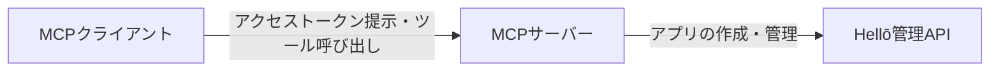
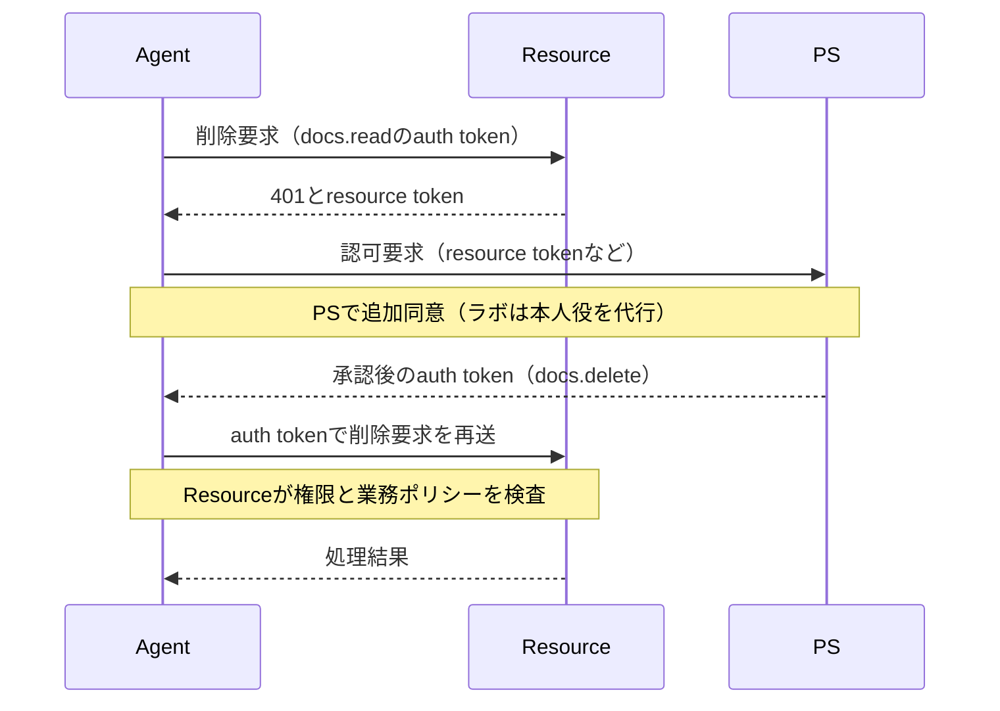
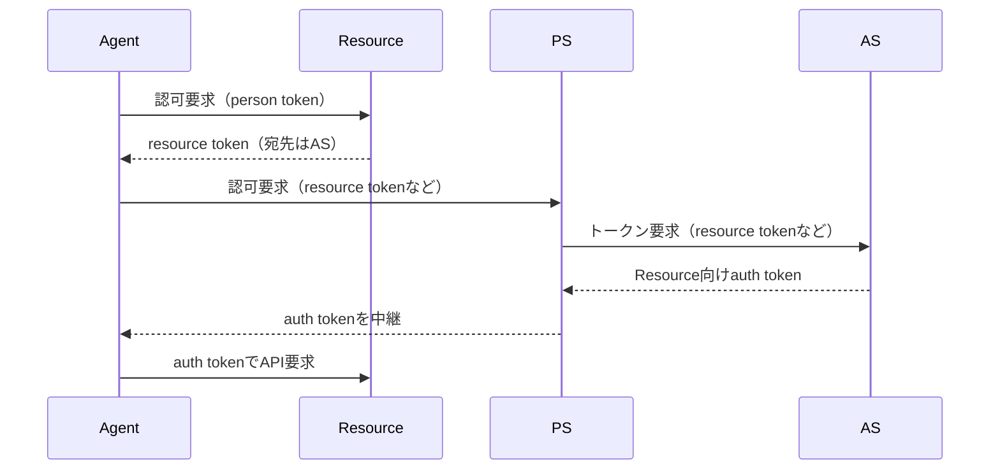

# AAuthをめぐるAIエージェントの認可設計の議論

> 推敲中の原稿です。調査基準日は2026年10月9日です。2026年10月10日に主要な一次資料を部分照合し、10月11日に背景説明の公式資料を追加確認しました。仕様の説明と再現実験は `draft-hardt-oauth-aauth-protocol-11` に固定します。実験結果は未実測で、正式公開に向けた確認を残しています。

「Google Driveから、先週の会議資料を探して」。CodexでGoogle Driveのプラグインを接続していれば、自分でDriveを開いて検索する代わりに、資料探しを任せられます。[OpenAIのプラグイン案内](https://learn.chatgpt.com/docs/plugins)

ここからは、読み取り・移動・削除ができる仮想の文書管理サービスを考えます。「古い資料を整理して」と任せるなら、資料を探すために与えた権限で、削除までできてよいのでしょうか。読むことと、保存された資料を変更することでは、任せる範囲が異なります。

この記事では、誰が追加の許可を判断し、操作を実行する側が何を検査するかを考えます。OAuthとその拡張でできる制御を確かめた上で、AAuthという認可プロトコルの提案がその判断をどう分担し、何が議論になっているのかを整理します。

この例では、エージェントは文書管理サービスへ操作を要求するための仕組みであるAPIを使います。途中で削除が必要になったときに、本人への確認、許可の伝達、APIでの検査がどうつながるかを追います。

例として、読むことと分類することは最初から許し、移動や削除には追加の許可を求めることにします。これは説明のために置く方針であり、すべての仕事やAAuthの仕様が求めるものではありません。

エージェントが文書Aの削除を必要と判断したら、本人に何を確認し、その返答を誰が受け取るかを決める必要があります。承認・拒否・判断待ちによって、その後の処理も変わります。判断を待つ間は、APIが削除を実行しない状態を保たなければなりません。

本人が「文書Aの削除」を承認したなら、実行するAPIもその対象に従う必要があります。画面でAを示していても、渡した権限がすべての文書の削除を許し、APIが対象を検査しなければ、別の文書Bも削除できてしまいます。承認した対象を許可に表し、APIでその制約を強制して初めて、確認画面と実際の処理が結び付きます。

ここでいうトークンは、APIへのアクセス権限や要求を送る主体に関する情報を、システム間で伝えるデータです。LLM（大規模言語モデル）が文章を処理・生成するときの単位である「トークン」とは意味が異なります。

有効なトークンを使った要求であること、操作が権限の範囲内であること、操作が本人の今の意図に沿うことは、別々の条件です。初めから広い削除権限を与えていた場合、エージェントが重要な文書を不要と判断しても、認可の検査は通り得ます。認可プロトコルが検証する情報と、仕事としてその操作が適切かという判断を区別して考えます。

この例で見たのは、権限の範囲、本人への確認、APIでの制約を結び付ける必要があることです。操作の限定や途中の確認は、OAuthとその拡張でも構成できます。AAuthが何を設計し直そうとしているかを考えるには、まずOAuthが提供してきた制御を押さえる必要があります。そこから、MCPサーバー開発で具体化した実装判断と、Dick HardtによるAAuthの設計・議論を追います。対象は個人提出のInternet-Draftであり、標準化が完了した仕様としては扱いません。[AAuth protocol-11](https://datatracker.ietf.org/doc/html/draft-hardt-oauth-aauth-protocol-11)、[Datatrackerの対象版](https://datatracker.ietf.org/doc/draft-hardt-oauth-aauth-protocol/11/)

## 1. OAuthによるアプリケーションへの権限の委譲

### パスワード共有とアクセス権の委譲

OAuthが導入される前の委譲方法の一つに、本人のユーザー名とパスワードを第三者のアプリへ渡す方法がありました。2012年のOAuth 2.0のRFCは、この方法ではアプリが本人の秘密情報を保管し、本人と同じ資格情報で広くアクセスできてしまう点を問題として挙げています。一つのアプリだけを止めたい場合にも、パスワードの変更が他のアプリへ影響します。[RFC 6749 §1](https://www.rfc-editor.org/rfc/rfc6749#section-1)

RFC 6749の§1は、こうした問題への対応を次のように説明します。

> OAuth addresses these issues by introducing an authorization layer and separating the role of the client from that of the resource owner.
>
> 出典：[RFC 6749（2012年10月）§1](https://www.rfc-editor.org/rfc/rfc6749.html#section-1)

認可の層を設け、クライアントとリソース所有者の役割を分けるという説明です。2012年10月にRFC 6749として公開されたOAuth 2.0は、本人のパスワードをクライアントへ渡す代わりに、認可サーバーが限定されたアクセス権を表すアクセストークンを発行するモデルです。クライアント、認可サーバー、リソースサーバー、リソース所有者の役割を分け、本人の資格情報を扱う処理と、アプリが許可された範囲でAPIを使う処理を分離します。[OAuth 2.0 / RFC 6749 §1](https://www.rfc-editor.org/rfc/rfc6749#section-1)

このモデルはGoogle APIやMicrosoft GraphなどのAPIへの委任アクセスに使われています。エージェントもAPIを利用するクライアントとして、この認可基盤を使えます。ここでいう認可はアクセスを許す判断であり、本人が誰かを確かめる認証とは目的が異なります。ログインとAPIの利用許可が同じ画面に現れても、本人の確認とアクセス権の付与は別の処理です。[GoogleのOAuth 2.0案内](https://developers.google.com/identity/protocols/oauth2)、[Microsoft Graphの委任アクセス](https://learn.microsoft.com/en-us/graph/auth-v2-user)

### 追加同意と操作の制限

本人の資格情報を渡さずに済んでも、アプリへどこまで任せるかは別に設計します。冒頭の例なら、読み取りの権限で始め、削除が必要になった時点で追加同意を求める構成をOAuthでも採れます。追加同意、再認証、操作直前の確認のうち何を求めるかは、アプリケーションの方針です。

許可を細かく表現する拡張がRAR（Rich Authorization Requests）です。RFC 9396のAbstractは、追加する情報を次のように説明します。

> This document specifies a new parameter `authorization_details` that is used to carry fine-grained authorization data in OAuth messages.
>
> 出典：[RFC 9396（2023年5月）Abstract](https://www.rfc-editor.org/rfc/rfc9396.html#abstract)

`authorization_details`は、細かな認可条件をOAuthメッセージに載せるためのパラメーターです。単純なscope文字列では表しにくい対象や操作を、JSONの認可要求に記述します。文書Aだけを対象にする設計にも使えますが、対象・操作の意味をAPIごとに定義し、実行側で制約を強制する必要があります。通常の削除scopeを取得するだけで「Aを一度だけ削除する許可」になるわけではありません。[RAR / RFC 9396](https://www.rfc-editor.org/rfc/rfc9396)

### トークンと鍵の結び付け

限定したトークンでも、盗まれて使われれば許可の範囲内で被害が生じます。DPoP（Demonstrating Proof of Possession）は、アクセストークンを公開鍵へ結び付け、使用時に対応する秘密鍵の所持を証明する拡張です。トークンだけを盗まれた場合の不正使用を抑えます。ただし、RFC 9449の§3は、クライアント認証との役割の違いを明示しています。

> The DPoP mechanism presented herein is not a client authentication method.
>
> 出典：[RFC 9449（2023年9月）§3](https://www.rfc-editor.org/rfc/rfc9449.html#section-3)

DPoPが示す鍵の所持と、クライアントそのものの認証は別の処理です。必要ならクライアント認証と併用できます。鍵の所持だけでアクセスを許す仕組みでもありません。トークンの有効性と権限の検査は引き続き必要です。[DPoP / RFC 9449 §3](https://www.rfc-editor.org/rfc/rfc9449#section-3)

OAuthと拡張には、委譲した権限を狭め、使用する鍵を確かめる手段があります。それを実際のシステムへ組み込む際には、クライアント登録をどう管理し、追加確認をどこで行い、トークンをどこへ保管するかを決める必要があります。

## 2. HellōのMCPサーバー開発で表面化した認可の課題

この実装判断が現れた具体例として、HellōのMCPサーバー開発を取り上げます。MCP（Model Context Protocol）は、AIアシスタントなどのアプリケーションを、外部のデータやツールへ接続するためのプロトコルです。[MCP 2025-06-18の概要](https://modelcontextprotocol.io/specification/2025-06-18) 既存の管理APIをそのツールとして提供したHellōの事例は、登録、削除の確認、トークン保管の配置を考える手掛かりになります。

Hellōは、GoogleやAppleなどのログイン手段を、OpenID Connect（OIDC）による一つの接続でアプリに組み込める認証サービスです。開発者は自分のアプリをHellōに登録し、名前、ロゴ、ログイン後の戻り先などを設定します。Developer ConsoleやQuickstartが使う管理APIはOAuthで保護されており、その操作をAIアシスタントへ提供するのがHellōのMCPサーバーです。[Hellō](https://www.hello.coop/)、[Getting Started](https://www.hello.dev/docs/getting-started/)、[Admin API](https://www.hello.dev/docs/apis/admin/)、[Admin MCP Server](https://www.hello.dev/docs/admin-mcp/)

2025年8月4日、HardtはHellōのアプリを作成・管理するMCPサーバーの実装を紹介しました。VS Code、Cursor、Claudeなどのクライアントから、管理APIをツールとして呼び出す試みです。[Hardt「Say Hellō to AI」](https://blog.hello.coop/posts/say-hello-to-ai)

### Hellō管理APIへの接続

MCPの2025年6月18日版は、HTTPで認可を使う場合にOAuth 2.1ベースのフローを推奨しています（SHOULD）。MCPで認可を使うこと自体は任意で、stdioでの実行は別に扱います。Hellōの例は、保護された管理APIをクライアントから呼ぶために、この認可を組み込む場面です。[MCP 2025-06-18 Authorization](https://modelcontextprotocol.io/specification/2025-06-18/basic/authorization)

この例には二種類のアプリ登録が出てきます。一つは、Hellōログインを使う開発者のアプリを、名前・ロゴ・戻り先などとともに登録する業務上の操作です。登録されるHellōアプリのClient IDは、ログイン設定に使います。これが管理APIの操作対象です。[Getting Started](https://www.hello.dev/docs/getting-started/)

もう一つは、その管理操作を呼び出すMCPクライアントのOAuth登録です。DCR（Dynamic Client Registration、動的クライアント登録）を使う場合、呼び出し側のメタデータを認可サーバーへ送り、OAuthの`client_id`などを受け取ります。このIDは保護されたMCPサーバーへの接続に使い、管理対象のHellōアプリのClient IDとは目的が異なります。[DCR / RFC 7591](https://www.rfc-editor.org/rfc/rfc7591)、[MCPのクライアント登録](https://modelcontextprotocol.io/specification/2025-06-18/basic/authorization#dynamic-client-registration)

本人の権限で管理APIを使うには、クライアント登録とは別に本人のログインと同意を経て、アクセストークンを取得します。OAuthの`client_id`は呼び出し側を識別する値であり、本人のIDや削除の許可を表しません。次の図は、登録とアクセストークン取得を済ませた後のツール呼び出しだけを示します。Hardtの実装の通信記録ではなく、トークンの形式や管理APIへの資格情報の渡し方も特定しません。

### クライアント登録の運用

Hardtは、利用者が開発環境を切り替えるたびに登録が増え、使われなくなった登録のライフサイクルを管理する負担を懸念しました。記事で述べた対応は、MCP向けの登録要求に共通の`client_id`を返し、任意の`redirect_uri`を受け入れるというものでした。これは著者がその実装で選んだ対応です。MCPやOAuthが一般に勧める構成として読み替えることはできません。[Hardtの登録に関する説明](https://blog.hello.coop/posts/say-hello-to-ai)

Hardtが述べた負担と、MCP仕様の要求水準は分けて読みます。2025年6月18日版のAuthorization FlowのOverviewには、次の規範文があります。

> Authorization servers and MCP clients SHOULD support the OAuth 2.0 Dynamic Client Registration Protocol (RFC7591).
>
> 出典：[MCP 2025-06-18 Authorization「Overview」](https://modelcontextprotocol.io/specification/2025-06-18/basic/authorization#overview)

認可サーバーとMCPクライアントにDCR対応を推奨するSHOULDです。前述のとおり認可自体は任意で、HTTPで認可を使う場合の仕様として読みます。同版のDCR節は、非対応の認可サーバーについて、固定IDや手動登録した情報を利用者が入力するUIという代替も記述しています。登録を実装する仕組みと登録情報をどう保持するかは別の判断であり、RFC 7591にも共有のクライアントID、ステートレスな登録、software statementなどの議論があります。DCRやMCPが、個々のインスタンスについて永続的な登録を無制限に作ることを必須としているわけではありません。[RFC 7591 付録A](https://www.rfc-editor.org/rfc/rfc7591#appendix-A)、[MCP 2025-06-18 Authorization](https://modelcontextprotocol.io/specification/2025-06-18/basic/authorization#dynamic-client-registration)

### 削除の確認

HellōのWebコンソールでは、削除の際に利用者が`DELETE`と入力して操作を確認します。Hardtは、MCP経由の呼び出しにも同じ確認をどう設けるかという問題を挙げました。そこで`mcp` scopeでは読み取り・作成・追加的な更新を許し、削除を除外しています。削除を含む管理操作の権限と、エージェントへ渡す権限を分けた選択です。[Hardtのscopeと確認フローの説明](https://blog.hello.coop/posts/say-hello-to-ai)

削除をscopeから外せば、その権限での削除を止められます。削除も提供するなら、本人が対象を見て確認する経路と、その返答を実行へ結び付ける経路が要ります。2025年6月18日版MCPにはElicitationがあり、サーバーから入力を求め、利用者が`accept`、`decline`、`cancel`を返す仕組みがありました。Hellōが採用しなかった理由や対象クライアントの対応状況は、今回の資料では確認できません。[MCP 2025-06-18 Elicitation](https://modelcontextprotocol.io/specification/2025-06-18/client/elicitation)

### トークンの保管

もう一つの懸念は、クライアントが保持するトークンでした。Hardtは漏えいの危険を考慮して、アクセストークンを再取得するためのrefresh tokenを発行せず、必要になったら再認可する方針を述べています。これは漏えい事故の報告ではありません。長く使える秘密情報をどの実行環境に置き、失効や再認可を誰が管理するかという設計上の懸念です。[Hardtのトークン保管に関する説明](https://blog.hello.coop/posts/say-hello-to-ai)

Hellōでは、削除を除くscopeとrefresh tokenを発行しない方針で、クライアントへ渡す権限と資格情報を限定しました。それでも、クライアントの接続先が増えると、接続先ごとに認可フローとトークンを管理し、必要な対話を仲介する仕事はクライアントに残ります。Hardtは、実装記事のLessons Learnedでこの配置を次のように評価しています。

> OAuth between the client and server is not a good fit in my opinion.
>
> 出典：[Dick Hardt「Say Hellō to AI」（2025年8月4日）Lessons Learned](https://blog.hello.coop/posts/say-hello-to-ai)

クライアントとサーバーの間にOAuthを置く構成が適さない、というHardt本人の見解です。MCPやOAuthの仕様上の結論とは区別します。同じ記事では、拡張で課題を解ける可能性にも触れた上で、リソースの認可をMCPサーバー側へ移し、既存APIにはOAuthを使えると述べています。この問題設定から、処理の配置を変えるSEP 1299の提案へ進みます。[SEP 1299](https://github.com/modelcontextprotocol/modelcontextprotocol/issues/1299)

## 3. MCPの認可に関する提案からAAuthに至る経緯

### 認可処理のサーバー側への移管

Hardtは実装記事と同じ2025年8月4日に、MCPのSEP 1299を提出しました。SEPはSpecification Enhancement Proposal、仕様の改善提案です。この提案では、接続先の発見、OAuthフローの管理、トークンの保持などをMCPサーバー側へ移します。動機として挙げたのは、Hellōの実装経験とIETF 123での議論を踏まえ、いくつかの用途ではMCPクライアントとサーバーの間にOAuthを置く構成が適さないと考えたことでした。これは提案者による問題の捉え方です。[SEP 1299のMotivation](https://github.com/modelcontextprotocol/modelcontextprotocol/issues/1299)

クライアントはインスタンスに対応する鍵を持ち、HTTP要求へ署名します。サーバーは必要なときに利用者との直接の対話を求め、その後の処理を続けます。背後のAPIへ接続するためのOAuthは維持できます。たとえばMCPサーバーがOAuthのアクセストークンを取得して既存APIを呼び出し、MCPクライアント側ではそのトークンを保持しない構成を考えられます。

情報をサーバー側へまとめる分、クライアントの実装負担は減り得ます。サーバーには、複数利用者の情報を保管し、取り違えずに使う責任が増えます。SEP自身も、サーバー侵害による複数利用者のトークンの露出を挙げています。保管場所の変更は、信頼先と侵害時の影響の変更でもあります。[SEP 1299の設計とSecurity Considerations](https://github.com/modelcontextprotocol/modelcontextprotocol/issues/1299)

2025年9月2日、Dick Hardt（`dickhardt`）は、URL elicitationの受理で「提案のその部分」が重複すると説明してSEP 1299を閉じ、HTTP署名のSEP 1415を作成したと記しました。文脈上はURLを介した対話部分を指すと読めますが、提案全体の採用を述べたものではありません。このコメントは2026年10月10日に照合しました。SEP 1415全体の採用状況は未確認です。[閉鎖理由のコメント](https://github.com/modelcontextprotocol/modelcontextprotocol/issues/1299#issuecomment-3244750018)、[SEP 1415](https://github.com/modelcontextprotocol/modelcontextprotocol/issues/1415)

### 独立したプロトコルの提案

AAuthの最初のIETF（Internet Engineering Task Force）Internet-Draftとして参照する`draft-hardt-aauth-protocol-00`は、2026年4月2日公開です。対象の`draft-hardt-oauth-aauth-protocol-11`は、2026年9月25日公開の版です。初稿の公開日は文書として追える節目ですが、構想の誕生日を意味しません。初稿は経緯の資料とし、仕様説明と実装の根拠にはprotocol-11だけを使います。後続版やeditor’s copyの内容は、この版の説明や実験へ取り込みません。[最初のInternet-Draft](https://datatracker.ietf.org/doc/html/draft-hardt-aauth-protocol-00)、[protocol-11](https://datatracker.ietf.org/doc/html/draft-hardt-oauth-aauth-protocol-11)

SEPのクライアントインスタンスの鍵、署名付き要求、認可処理の配置という関心は、AAuthにも見られます。構成は同じではありません。SEPがMCPサーバーへ処理をまとめるのに対し、AAuthは本人を代表するPerson Serverを役割として取り出し、APIを提供する側との関係を定めます。MCPの改善提案がそのままAAuthの標準化になったという経緯は確認していません。両者は参加者も採否の手続きも異なります。

## 4. AAuthの登場主体と各主体が担う認可処理

### 登場主体

本人側の判断とAPI側の検査をどう結び付けるかを読むため、protocol-11に登場する役割を先に整理します。本人（User／仕様上のPerson）と、本人を代表するサーバー（PS）は別の主体です。どの役割が認可に加わるかはアクセスモードによって異なります。[protocol-11 §4.3–4.4](https://datatracker.ietf.org/doc/html/draft-hardt-oauth-aauth-protocol-11#section-4.3)、[protocol-11 §4.2](https://datatracker.ietf.org/doc/html/draft-hardt-oauth-aauth-protocol-11#section-4.2)

| 日本語名・呼称 | 役割 | 登場するモード |
|---|---|---|
| 本人：User（仕様上はPerson） | Agentが代理する人または組織で、必要な同意・監督を行います。 | 対話は必要に応じて行います。Agentの識別だけでアクセスする構成では、Resourceへの本人識別を要求しません。 |
| エージェント：Agent | 本人の依頼に基づいて操作を選び、署名付き要求を送ります。 | 全モード |
| エージェント提供者：Agent Provider（AP） | Agentの識別子と公開鍵を結び付けるagent tokenを発行します。 | 全モードのトークン発行元 |
| 本人側サーバー：Person Server（PS） | 本人側の判断とperson tokenの発行を担い、認可モードに応じてauth tokenを発行または仲介します。 | 本人の識別を使う構成、PSが認可する三者構成、ASと連携する四者構成 |
| アクセスサーバー：Access Server（AS） | リソース側のポリシーを評価し、auth tokenを発行します。 | ASと連携する四者構成 |
| リソース：Resource | 必要なアクセス条件を示し、トークン・署名と業務ポリシーを検査して実行を判断します。 | 全モード |

役割は、別々のサーバーとして配置することを意味しません。二者・三者・四者という数は主要なプロトコル参加者を数え、通常APと本人を含めません。APとの通信も毎要求で発生するわけではありません。以下は、PSが認可する三者構成を中心に説明し、ASが加わる四者構成との差を後で示します。五つのモードと初回同意の条件は末尾の補足にまとめます。

### 本人側の許可とAPI側の検査

冒頭の資料整理の例に戻ると、文書Aの削除を本人側の方針で許すかは、PSが判断します。PSのSupervisorは、要求された権限を許可するか、本人へ確認するか、拒否するかを決める機構です。事前の方針で許せる要求まで、人間が毎回判断する構成に限りません。[protocol-11 §7、§8](https://datatracker.ietf.org/doc/html/draft-hardt-oauth-aauth-protocol-11#section-7)

削除を実行するResourceは、届いたトークン、要求の署名、必要なscopeを検査した上で、対象への業務ポリシーを適用します。所有者の一致を確かめることと、保護文書の削除を禁止することは別のポリシーです。本人側が削除を許しても、Resourceが禁止する文書を削除できるわけではありません。PSが発行した権限と、実行する操作をResourceが照合して、この分担が成立します。[protocol-11 §4.4](https://datatracker.ietf.org/doc/html/draft-hardt-oauth-aauth-protocol-11#section-4.4)、[protocol-11 §4.3–4.4](https://datatracker.ietf.org/doc/html/draft-hardt-oauth-aauth-protocol-11#section-4.3)

文書Aだけを許すには、対象の制約を表す情報とResource側の検査も必要です。許可の取得とAPIの検査を観測するため、以下では架空の文書APIを使うラボを例にします。

ラボでは、この分担を段階的に確かめるため、まず通常の`docs.delete` scopeへの追加同意と実行時の検査を扱うことにします。AAuthがすべての削除に追加同意を義務付けるわけではありません。このscopeは「文書Aを一度だけ削除する許可」と同義ではなく、対象や回数を限定する制御は後続検証へ分けます。

### 追加許可の取得

読み取りの権限しかないAgentが削除を求めると、Resourceは不足する権限をresource tokenに表します。AgentはそれをPSへ提示し、PSは検証と判断を経て、許可した範囲をauth tokenとして発行します。resource tokenは権限の要求を伝え、auth tokenは許可された権限を伝えます。ここではprotocol-11の名称に従い、OAuthのaccess tokenと区別します。[protocol-11 §6、§7](https://datatracker.ietf.org/doc/html/draft-hardt-oauth-aauth-protocol-11#section-6)

本人へ確認するときには、Resourceが示す要求と、Agentが示す理由を区別します。Agentが「この文書を削除すれば作業が終わる」と説明しても、それはAgent側の主張です。PSが表示する同意画面では、Resourceが何の権限を要求したかと、Agentのjustificationを混ぜずに示す設計になっています。最終的に許すscopeは、本人やSupervisorの判断を経て決まります。[protocol-11 §7.4](https://datatracker.ietf.org/doc/html/draft-hardt-oauth-aauth-protocol-11#section-7.4)

次の図は、削除に必要な権限が足りないことを示すHTTP 401応答の後に、追加許可を取得し、削除要求を再送する成功経路です。署名付き要求を前提とし、本人との対話、PSとの承認待ちの通信、署名検証の細部は省略します。固定スクリプトのAgent・PS・架空の文書APIを使うラボの設計・検証条件であり、実行結果は未実測です。202によるResource側の保留は第6節で区別します。

判断待ちや拒否、`docs.delete`を含まない範囲への権限縮小では、削除の実行記録がなくデータも変わらないことを確認します。承認後もResourceの検査を通る必要があります。ただし、ラボの初回紐付けと最初の承認はテスト用の代行処理で、同意画面にも本人認証がありません。Agentも自分の要求を承認できるため、この流れから本人の判断が守られることを実証できません。

### トークンと署名による検証

PSが要求を受け入れるには、どのAgentの要求で、どの鍵を使っているかを確認します。APのagent tokenはAgentの識別子と公開鍵を結び付けます。PSはそこからAgentを識別し、person tokenではその鍵と、代理される本人との結び付きを示します。person token自体はscopeやアカウントの権限を表すものではありません。[protocol-11 §5](https://datatracker.ietf.org/doc/html/draft-hardt-oauth-aauth-protocol-11#section-5)、[protocol-11 §7.1](https://datatracker.ietf.org/doc/html/draft-hardt-oauth-aauth-protocol-11#section-7.1)

Resourceが常にAgentの識別子を見るわけではありません。person tokenでは本人の識別情報と公開鍵を確かめ、auth tokenではそれに加えて許可されたscopeを検証します。JWT（JSON Web Token）の署名は発行元がトークンを発行したことを、HTTP要求の署名は対応する鍵の使用を確かめます。期限、宛先、scope、対象のポリシーはそれぞれ別に検査します。署名が通ったことだけで削除を許す判断は完結しません。[protocol-11 §11.3、§11.5](https://datatracker.ietf.org/doc/html/draft-hardt-oauth-aauth-protocol-11#section-11.3)

### Missionと本人の意図

鍵と権限を確かめても、その削除が依頼に必要かは分かりません。Missionは、Agentが何の仕事を行うかという文脈をPSへ伝える枠組みです。PSは要求された権限を仕事の文脈と照らして判断できます。ただし、Missionの記述や`approved_tools`が、そのまま対象・回数の制約や、すべてのローカルツール実行の強制へ変わるわけではありません。[protocol-11 §8](https://datatracker.ietf.org/doc/html/draft-hardt-oauth-aauth-protocol-11#section-8)

Agentが外部の文章に誘導され、保有する鍵で要求へ署名した場合も、署名は正しく検証され得ます。署名は要求が本人の意図に沿うことの証明ではなく、AAuthはプロンプトインジェクション防止を保証しません。

### リソース側の認可と四者構成

ここまでの三者構成ではPSがauth tokenを発行しました。リソース側のポリシーに基づく発行判断をASへ分けるのが、Federated Authorizationの四者構成です。PSは本人側の判断を担い、ASはリソース側の方針に従ってauth tokenを発行します。発行された権限をAPIの実行時に検査して強制する役割は、Resourceに残ります。[protocol-11 §4.4、§9](https://datatracker.ietf.org/doc/html/draft-hardt-oauth-aauth-protocol-11#section-4.4)

次の図は、四者構成でResource向けauth tokenを取得する経路だけを示します。初回の本人との結び付けと同意、APからのagent token取得、メタデータ取得、署名検証、承認待ちは省略します。ASのtoken endpointを呼ぶのはPSであり、AgentはPSが中継したauth tokenをResourceへ提示します。[protocol-11 §4.2.5、§9.3](https://datatracker.ietf.org/doc/html/draft-hardt-oauth-aauth-protocol-11#section-4.2.5)

この分離により、本人側とリソースを管理する側は、それぞれの方針を発行判断へ反映できます。同時に、PSとASの間に信頼関係を設け、連携を運用する責任が増えます。四者構成をすべての接続へ適用する必要はありません。何を別の管理主体へ任せるかによって構成を選び、その配置が既存のOAuth構成と比べてどの負担を減らし、どの負担を増やすかを評価します。

## 5. AAuthはOAuthの拡張か、新しいプロトコルか

Hardtはprotocol-11の付録C.4.5で、必要な変更をOAuthへ重ねると後方互換性を失い、別物になると判断しています。その文の後半では、AAuthの設計方針を次のように記しています。

> AAuth is a new protocol designed for the agent model from the ground up.
>
> 出典：[AAuth protocol-11（2026年9月25日、個人提出のInternet-Draft）付録C.4.5](https://datatracker.ietf.org/doc/html/draft-hardt-oauth-aauth-protocol-11#appendix-C.4.5)

Agentのモデルを出発点に、新しいプロトコルを設計するという著者の方針です。サーバーをまたいで確認できるAgentの識別、鍵への結び付け、本人側の統治、リソース側との連携をまとめて扱うために、別の基礎を選ぶ理由として読みます。OAuth全般で同じ制御を実現できないという確定した結論でも、WGの合意でもありません。同じ付録では、既存OAuth基盤をAAuthの背後で利用し、PSが本人認証をOIDCへ任せる補完関係も述べています。新規プロトコルの提案と、既存基盤の利用は両立するという説明です。

2026年10月5日のOAuth作業部会の中間会合（interim）では、必要な機能をどの基礎の上に実装するかが争点になりました。Aaron Pareckiは、新しい要素を切り分けてOAuthの拡張として取り込む案を示しました。Dick Hardtは、異なる基礎に立つ解決策が必要だと応じています。既存基盤から不足する機能を取り込む案や、OAuth拡張とAAuthを併用する案も出ていました。[会合の公開ノート](https://notes.ietf.org/notes-ietf-interim-2026-oauth-06-oauth)、[公開チャットログ](https://datatracker.ietf.org/doc/chatlog-interim-2026-oauth-06-202610051300/)

Hardtも、OAuthへ機能を追加できる可能性自体は否定していません。既存のフローと運用に必要な要素を追加するか、Agentの鍵と本人側の判断を中心に構成を定め直すかという設計方針の違いです。既存の選択肢にはDPoPやRARに加え、取得したトークンを別のトークンへ交換して委譲・代理行動を扱うToken Exchangeもあります。多段のAPI接続でも、広い権限の同じトークンを配る以外の構成を選べます。[Token Exchange / RFC 8693](https://www.rfc-editor.org/rfc/rfc8693)

両構成を比較するには、インスタンスの識別、本人側とリソース側の方針、非同期の承認、資格情報の保管、既存APIへの接続を共通の条件として揃える必要があります。その条件の下で、実装量、信頼先、障害時の振る舞い、移行の負担を確かめます。追加同意のデモが成功しただけでは、プロトコルの優位性や運用全体の単純さを示せません。

公開ノートは、議長がメーリングリストで問う質問を検討するという記述で終わります。正式な議事録や採用決定として扱わず、ここからワーキンググループ（WG）の採用や新プロトコルへの合意は確認できません。2026年10月10日に会合資料を照合しましたが、その後の最新状態は未確認です。[公開ノート末尾](https://notes.ietf.org/notes-ietf-interim-2026-oauth-06-oauth/download)

## 6. AAuthで解決できること・残る課題と、本記事での検証計画

前節で挙げた信頼先や障害時の振る舞いを比べるには、トークンを発行できるかだけでなく、その前後の処理も確かめる必要があります。PSやASが発行した権限を受け入れる条件、承認を待つ間の処理、許可を取り消した後に実行を止める方法を整理し、比較の前提とラボで観測する対象を決めます。操作を特定の対象や回数に限定する条件も、通常のscopeとは分けて扱います。

### 信頼先と鍵の運用

公開鍵を取得して署名を検証できることと、その発行元を受け入れてよいことは別の条件になります。protocol-11の§9.3.1には、PSとASの信頼を確立する手続きが記述されているため、「信頼確立が未定義」とまとめるのは不正確です。その手続きを備えた上で、どのPSやAPを許すか、組織がどの表明を受け入れるかという信頼ポリシーを決める必要があります。[protocol-11 §9.3.1](https://datatracker.ietf.org/doc/html/draft-hardt-oauth-aauth-protocol-11#section-9.3.1)

鍵の生成、保管、更新、侵害時の対応は運用へ残ります。PSの侵害や利用不能の影響、複数端末で動くAgentの鍵と本人の結び付けをどこまで共有するかも、通信の図だけでは決まりません。

### 承認待ち・再試行・失効

追加許可を待つ方法には、401を返してAgentに再送を求める方式と、202を返してResourceが要求を保持する方式があります。202方式では、Agentがauth tokenを付けて保留先へ問い合わせると、Resourceが処理を再開します。操作を保持する主体が違うため、待機後の再開と再試行も分けて考えます。[protocol-11 §6.5.1](https://datatracker.ietf.org/doc/html/draft-hardt-oauth-aauth-protocol-11#section-6.5.1)

鍵とトークンを正しく管理していても、承認待ちの間に期限が切れる場合があります。一方、処理は完了したのに応答だけ受け取れなかった場合には、再認可するだけでは二重実行を防げません。認可の再取得、保留の終了、結果の再取得、再実行の抑止を分けて検討します。401の再送と202の保留の違いが、ここで必要になります。

ラボの202方式では、同じ保留操作へ再pollすると保存済みの結果を返し、再実行しない設計です。この制御は、取得したauth token全体を一回限りにするものではありません。別の要求まで制限するには、scopeやResourceのポリシーを別に確認します。[protocol-11 §11.10](https://datatracker.ietf.org/doc/html/draft-hardt-oauth-aauth-protocol-11#section-11.10)

失効について、protocol-11はPS・ASと、person tokenを受け付けるResourceのrevocation endpoint対応をSHOULDとしています。未対応や通知の未到達により、失効したトークンが期限まで受理される場合もあります。Missionの終了と、すべてのResourceでの即時停止は同じ保証ではありません。[protocol-11 §11.12](https://datatracker.ietf.org/doc/html/draft-hardt-oauth-aauth-protocol-11#section-11.12)

### 操作単位の許可

特定の対象や一度限りの実行を扱うには、通常のscopeに加えて制御が要ります。protocol-11はR3をcompanion specificationとして参照し、公式サイトでは呼び出し単位のgrantを扱う探索的な仕様として紹介しています。操作単位の許可がAAuthで一切扱えないとはいえませんが、R3の詳細、対象版、成熟度、実行側で強制される範囲は今回未確認です。ラボではResourceの明示的なポリシーと、R3を扱う後続検証を分けて進めます。[protocol-11 §6.7.1](https://datatracker.ietf.org/doc/html/draft-hardt-oauth-aauth-protocol-11#section-6.7.1)、[AAuth公式サイト](https://aauth.dev/)

署名済みの文書Aへの要求をBへ改ざんすることと、承認後にBへの新しい要求を正しく署名することは、別の試験です。前者は署名対象の改ざんとして検出できても、後者は通常の`docs.delete`とResourceのポリシーが許せば実行できてしまいます。[protocol-11 §11.10](https://datatracker.ietf.org/doc/html/draft-hardt-oauth-aauth-protocol-11#section-11.10)

ラボでは、まず読み取り権限のまま削除できないこと、追加同意を待つ間や拒否された後にデータが変わらないこと、承認後に適切な権限で削除できることを調べます。通信順序、判断主体と理由、APIの実行記録、データの前後差分を対応付けて、許可取得と実行を区別して観測します。結果はprotocol-11とラボの条件の範囲で説明し、本人の意図の正しさやプロンプトインジェクション防止を検証したことにはしません。

### 補足：ラボの検証条件と未実施事項

`aauth-lab`では、固定スクリプトのAgent、PS、架空の文書APIを持つResourceで三者の認可フローを観測します。APはテスト用のagent tokenとメタデータの発行元です。初期の認証情報取得を行うbootstrapはラボの処理で代替し、独立したAS、大規模言語モデル、多段の呼び出しは初期範囲に含めません。条件は[ルートREADME](../../README.md)に置いています。

現時点でコードは存在しますが、今回の執筆作業ではサーバーの起動やテストを実行していません。実装はprotocol-11に未準拠で、[仕様対応表](../conformance-11.md)もコード読解による記録です。同意画面には本人認証がなく、Agentが自分の要求を承認できます。Aliceへの初回の結び付けと最初の承認もテスト用の代行処理であり、本人確認と初回同意を検証したことにはなりません。承認の状態遷移を観測できても、本人の判断が守られた証明にはできません。

鍵の不一致、期限切れ、別のaudience、無効なJWT署名、署名後のHTTP要求の改ざんは、それぞれ独立した陰性試験にします。たとえば期限切れを試す際はHTTP署名の時刻を有効に保ち、トークンの`exp`だけを失敗条件にします。画面にエラーが出たことやHTTPステータスだけで判断せず、APIの実行記録と前後のリソース状態を照合します。

> **実験結果は未実測です。** 実施後に、通信順序、公開token claims（トークン内の属性）、鍵thumbprint（公開鍵の識別用ハッシュ）、同意の状態遷移、判断主体と理由、データの前後差分を記載します。陰性試験とpending中の採取には追加検証が必要です。秘密鍵や本物の認証情報は記録せず、実データ・実アカウントも使いません。暗号演算・JWT・HTTP署名には信頼できるライブラリを使う方針ですが、既存のJWT組み立てとHTTP署名にはラボ独自の処理が残り、適合性確認は未完了です。

### 補足：署名対象

JWTの署名とHTTP Message Signaturesの検証だけで、要求中の全情報が保護されると考えてはいけません。基本の必須対象にはメソッド、接続先を表すauthority、URLのpath、`Signature-Key`が含まれます。Resource向け要求の本文やクエリまで常に署名されるわけではなく、追加対象はResourceが`additional_signature_components`で要求します。改ざんの試験では、変更した項目が実際に署名対象だったかを記録します。[protocol-11 §11.3.3.1、§11.2.4](https://datatracker.ietf.org/doc/html/draft-hardt-oauth-aauth-protocol-11#section-11.3.3.1)

署名の対象範囲について、RFC 9449の§11.7は次のように説明します。

> DPoP does not ensure the integrity of the payload or headers of requests.
>
> 出典：[RFC 9449（2023年9月）§11.7](https://www.rfc-editor.org/rfc/rfc9449.html#section-11.7)

要求の本文やヘッダー全体の完全性を、DPoP単独では保証しないという意味です。基本の対象にはHTTPメソッドとURI（Uniform Resource Identifier）などが含まれ、メッセージ全体の完全性はTLS（Transport Layer Security）にも依存します。AAuthとの比較では、どの要素を署名し、受信側が何を要求するかまで見る必要があります。[RFC 9449 §4.2](https://www.rfc-editor.org/rfc/rfc9449#section-4.2)

### 補足：五つのアクセスモードと初回の同意

protocol-11は五つのアクセスモードを定義しています。独立したPSとASをすべての接続へ必ず置く仕様ではありません。二者・三者・四者という数は、各モードの主要なプロトコル当事者を数えたもので、通常はAPや本人を含めません。[protocol-11 §4.2](https://datatracker.ietf.org/doc/html/draft-hardt-oauth-aauth-protocol-11#section-4.2)

| モード | 識別と認可の配置 |
|---|---|
| Agent Identity | エージェントの識別情報をResourceへ示す |
| Resource-Managed Two-Party | AgentとResourceの間で、Resourceが認可を管理する |
| Person Identity | PSのperson tokenで、代理する本人との結び付きをResourceへ示す |
| PS Authorization Three-Party | Agent・PS・Resourceで、PSが認可する |
| Federated Authorization Four-Party | Agent・PS・AS・Resourceで、本人側とリソース側の認可を分ける |

Person IdentityとPS Authorizationは、同じようにPSが登場しても意味が異なります。person tokenは、PS上の本人とエージェントの結び付きを表し、scopeやアカウントの権限を表すトークンではありません。ただし、Resourceが本人の識別情報だけでアクセスを判断する構成では、person tokenの発行が実質的なアクセスにつながります。単なる氏名の開示として軽く扱うことはできません。[protocol-11 §7.1、§13.8](https://datatracker.ietf.org/doc/html/draft-hardt-oauth-aauth-protocol-11#section-7.1)

初回の結び付けと同意には、独立した前提があります。§13.14は本人とAgentの結び付けを扱います。§13.8は、そのResource向け最初のperson tokenを本人の承認が必要なものとして扱うことを推奨しています（SHOULD）。組織管理者の事前承認など、前提は構成によって異なります。実験では、本人確認と初回同意を実施したのか、テスト用の前提に置き換えたのかを記録します。[protocol-11 §13.8、§13.14](https://datatracker.ietf.org/doc/html/draft-hardt-oauth-aauth-protocol-11#section-13.14)

### 補足：GNAPとの関係

認可プロトコルの再設計という点では、GNAP（Grant Negotiation and Authorization Protocol）も比較対象になります。2024年のRFC 9635は、クライアントと認可サーバーがアクセス権や対話の方法を交渉するプロトコルを定めています。OAuthの拡張、GNAP、AAuthは、課題の一部を共有しますが、採る構成や文書の位置付けが異なります。年代を並べるだけで「OAuthからGNAPへ、さらにAAuthへ」という必然的な進化にはできません。[GNAP / RFC 9635](https://www.rfc-editor.org/rfc/rfc9635)

### 補足：調査時点の公開issue

2026年10月9日基準の調査メモでは、Issue 108が承認を長く待つ間のトークンや鍵の有効期間を、Issue 222が同じ内容の正当な再試行とリプレイの区別を扱っています。本稿では、承認待ちの期限切れと応答消失後の再試行を分けて調べる根拠として参照します。[Issue 108](https://github.com/dickhardt/AAuth/issues/108)、[Issue 222](https://github.com/dickhardt/AAuth/issues/222)

Issue 221では中継時の本人の取り違えを検知する境界、Issue 208ではAPの自己ホストと独立した役割の説明の整合性が論点になっています。ここでは調査時点で挙がった論点として紹介し、issueがあることを実証済みの脆弱性とは扱いません。解決状況や後続版での変更は今回の全件再確認に含めておらず、公開前に更新する必要があります。[Issue 221](https://github.com/dickhardt/AAuth/issues/221)、[Issue 208](https://github.com/dickhardt/AAuth/issues/208)
